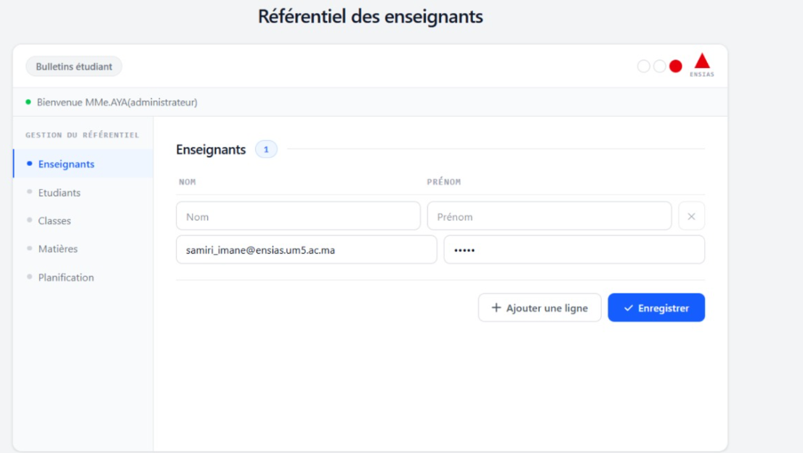
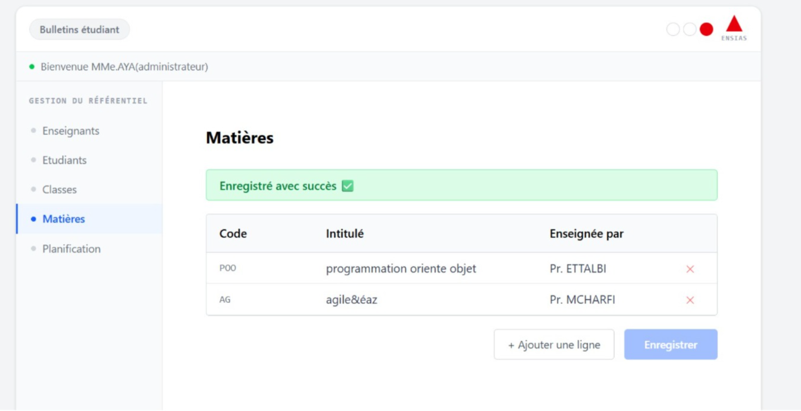
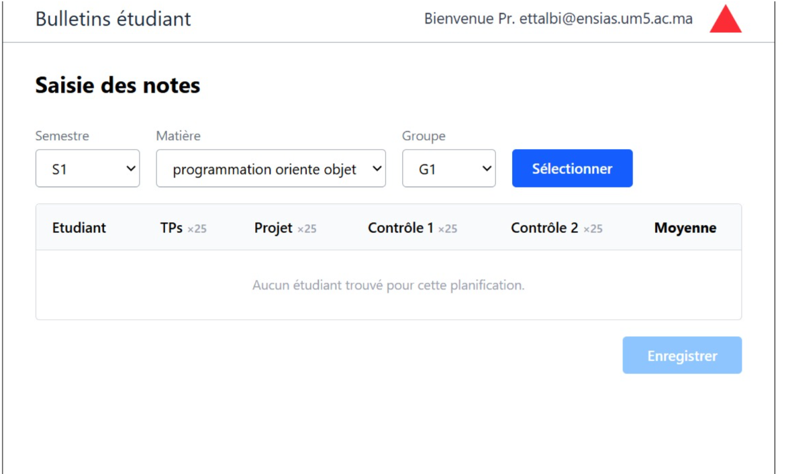
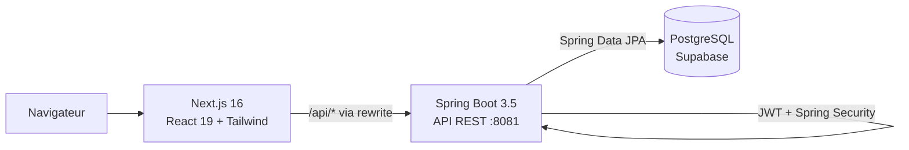

# Gestion des Notes — Application web de saisie et de consultation des notes

Application web de **gestion académique** destinée aux établissements d'enseignement supérieur. Elle permet de gérer le référentiel pédagogique (enseignants, étudiants, classes, groupes, matières), de planifier les enseignements, de saisir les notes avec calcul automatique des moyennes, et de consulter les bulletins.

Projet réalisé en équipe de 5 selon la **méthodologie Agile Scrum**, dans le cadre du module *Processus agiles*, 2ème année Génie Logiciel à l'**ENSIAS** (Rabat), 2025-2026.


---

## Sommaire

- [Fonctionnalités](#fonctionnalités)
- [Démarche Agile (Scrum)](#démarche-agile-scrum)
- [Captures d'écran](#captures-décran)
- [Architecture et stack](#architecture-et-stack)
- [Structure du projet](#structure-du-projet)
- [Lancer le projet](#lancer-le-projet)
- [API REST](#api-rest)
- [Équipe](#équipe)

---

## Fonctionnalités

L'application propose trois espaces, chacun protégé par une authentification **JWT** propre à son rôle.

**Administrateur**
- Référentiel des **enseignants** et des **étudiants**, avec ajout de plusieurs lignes avant validation et génération automatique du matricule
- Gestion des **classes** (année universitaire, niveau, spécialité, nombre de groupes), avec création multiple et filtre par année
- **Affectation** des étudiants aux classes et aux groupes
- Gestion des **matières** (code, intitulé)
- **Planification** : association matière, enseignant, semestre, classe et groupe, avec les coefficients de chaque type de note

**Enseignant**
- Sélection en cascade du semestre, de la matière, de la classe et du groupe. L'enseignant ne voit que ses propres affectations.
- **Saisie des notes** (TP, Projet, Contrôles) avec validation entre 0 et 20 et **calcul automatique de la moyenne** pondérée

**Étudiant**
- Choix du semestre et consultation du **bulletin** : notes, moyenne par matière et moyenne générale

Les mots de passe sont stockés sous forme de **hash SHA-256**.

## Démarche Agile (Scrum)

Le projet a été mené en **Scrum**, avec des sprints d'une semaine et un suivi sur **Jira**. Le rapport complet est disponible ici : [`docs/Rapport_Projet_Agile.pdf`](docs/Rapport_Projet_Agile.pdf).

| Pratique | Mise en œuvre |
|---|---|
| **Product Backlog** | 17 user stories priorisées collectivement selon la valeur métier, la complexité et l'urgence |
| **Estimation** | Planning Poker avec la suite de Fibonacci (vote silencieux, débat, revote jusqu'au consensus) |
| **Sprints** | Sprints d'une semaine avec objectif, sprint backlog et démo de l'incrément |
| **Daily Scrum** | Point quotidien : travail réalisé, obstacles rencontrés, objectifs du jour suivant |
| **Rétrospective** | Méthode des **4L** (Liked, Learned, Lacked, Longed for), avec actions d'amélioration appliquées au sprint suivant |
| **Outil** | Jira pour le backlog, le tableau de sprint et le suivi des tickets |

### Déroulement des sprints

| Sprint | Période | Objectif | User stories | Effort |
|---|---|---|---|---|
| **Sprint 1** | 15 → 22 mai | Socle applicatif, authentification des 3 profils et création des comptes | US-01 à US-05 | 24 SP |
| **Sprint 2** | 30 mai → 6 juin | Référentiel pédagogique, planification et saisie des notes | US-06 à US-12 | 19 SP |
| **Sprint 3** | *planifié* | Import CSV, gestion des comptes, autocomplétion, bulletin étudiant | US-13 à US-17 | 11 SP |

Après la rétrospective du Sprint 1, l'équipe a revu sa **vélocité** à la baisse (de 24 à 19 SP) pour mieux tenir l'engagement du Sprint 2.

## Captures d'écran

| Référentiel des enseignants | Référentiel des classes |
|---|---|
|  |  |
| **Gestion des matières** | **Saisie des notes (enseignant)** |
|  |  |

## Architecture et stack



| Couche | Technologies |
|---|---|
| Backend | Java 17, Spring Boot 3.5 (Web, Data JPA, Security), JWT (jjwt), Lombok, Maven |
| Frontend | Next.js 16 (App Router), React 19, TypeScript, Tailwind CSS 4, lucide-react |
| Base de données | PostgreSQL hébergé sur Supabase |
| Gestion de projet | Scrum, Jira, Git / GitHub |

## Structure du projet

```
Gestion-Notes/
├── backend/                         # API REST Spring Boot
│   └── src/main/java/com/gestionnotes/backend/
│       ├── config/                  # Sécurité, CORS, filtre JWT
│       ├── controller/              # Auth, Admin, Classe, Enseignant, Planification
│       ├── service/                 # Logique métier, JWT, hachage SHA-256
│       ├── entity/                  # User, Etudiant, Enseignant, Classe, Groupe, Matiere, Note...
│       ├── repository/              # Spring Data JPA
│       └── dto/                     # Objets de requête
├── frontend/                        # Application Next.js
│   ├── app/
│   │   ├── page.tsx                 # Connexion
│   │   ├── admin/                   # enseignants, etudiants, classes, matieres, planification
│   │   ├── enseignant/saisie-notes/
│   │   └── etudiant/notes/
│   ├── components/                  # Sidebar, Topbar, ReferentielTable, Toast
│   └── lib/api.ts                   # Client HTTP
└── docs/                            # Rapport Agile et captures d'écran
```

## Lancer le projet

Prérequis : Java 17, Node.js 20 et une base PostgreSQL (Supabase ou locale) avec le schéma de l'application.

**1. Backend**

```bash
cd backend
cp .env.example .env     # puis renseigner les valeurs
# Charger les variables, puis lancer :
export $(cat .env | xargs)
./mvnw spring-boot:run   # API sur http://localhost:8081
```

| Variable | Description |
|---|---|
| `DB_URL` | URL JDBC PostgreSQL, ex. `jdbc:postgresql://localhost:5432/gestion_notes` |
| `DB_USERNAME` | Utilisateur de la base |
| `DB_PASSWORD` | Mot de passe de la base |
| `JWT_SECRET` | Clé de signature des jetons JWT (32 caractères minimum) |

Sous Windows (PowerShell), il faut définir les variables avec `$env:DB_URL="..."` avant de lancer `mvnw spring-boot:run`.

**2. Frontend**

```bash
cd frontend
npm install
npm run dev              # http://localhost:3000
```

Next.js redirige automatiquement les appels `/api/*` vers le backend sur le port 8081.

## API REST

| Domaine | Routes principales |
|---|---|
| Authentification | `POST /api/auth/admin-login`, `/enseignant-login`, `/etudiant-login` |
| Référentiel (admin) | `/api/admin/enseignants`, `/etudiants`, `/matieres`, `/niveaux`, `/specialites`, `/annees`, `/semestres` |
| Classes et groupes | `/api/admin/classes`, `/classes/{id}/groupes`, `/groupes/{id}/etudiants` |
| Planification | `/api/admin/planifications`, `/planifications/{id}/etudiants` |
| Notes | `GET` / `POST /planifications/{id}/notes` |
| Espace enseignant | `/api/enseignant/{id}/semestres`, `/filters`, `/planifications` |

## Équipe

Projet réalisé par une équipe de 5 élèves ingénieurs, encadrée par **Pr. Zineb Mcharfi** :

- Fatima Ibaararen
- Soumia Amerkad
- Aya Nasser
- Ihssan Ben Labsir
- Wafae Barara
