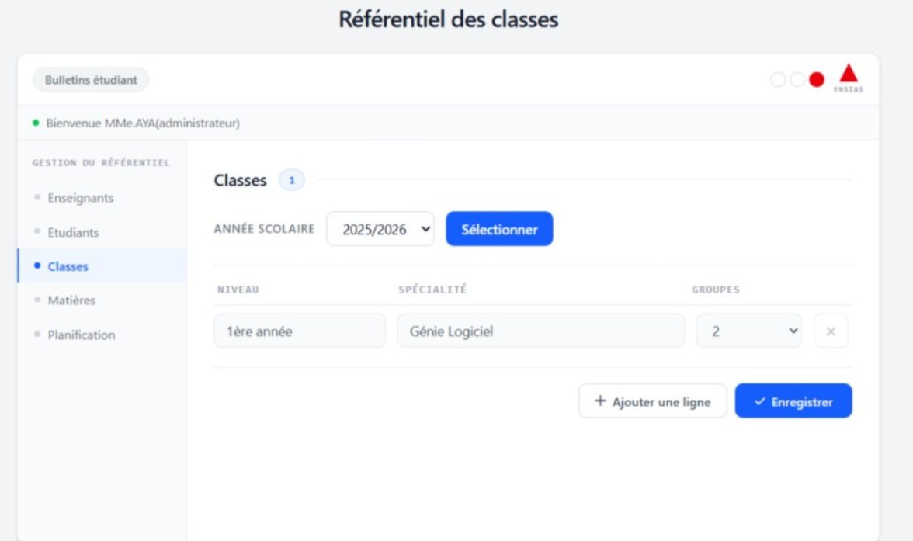

# Gestion des Notes

Application web de **saisie et de consultation des notes** pour un établissement d'enseignement supérieur, réalisée en équipe de 5 avec la **méthode Scrum**.

L'administrateur organise l'année (classes, groupes, matières, planification), l'enseignant saisit les notes et la moyenne est calculée automatiquement, et l'étudiant consulte son bulletin.


---

## Sommaire

- [Aperçu](#aperçu)
- [Fonctionnalités](#fonctionnalités)
- [Stack technique](#stack-technique)
- [Architecture](#architecture)
- [Lancer le projet](#lancer-le-projet)
- [API](#api)
- [Méthode Agile](#méthode-agile)
- [Prochaines étapes](#prochaines-étapes)
- [Équipe](#équipe)

---

## Aperçu

| Gestion des classes | Gestion des enseignants |
|---|---|
|  |  |

| Gestion des matières | Saisie des notes |
|---|---|
|  |  |

---

## Fonctionnalités

### Administrateur
- Création des comptes **enseignants** et **étudiants**
- Gestion du référentiel : années universitaires, niveaux, spécialités, **classes** et **groupes**
- Affectation des étudiants à un groupe
- Gestion des **matières** (code, intitulé)
- **Planification** : associer une matière et un enseignant à une classe, un groupe et un semestre, avec les coefficients

### Enseignant
- Choix du semestre, de la matière, de la classe et du groupe (uniquement ceux qui lui sont affectés)
- **Saisie des notes** : TP, Projet, Contrôle 1, Contrôle 2
- **Calcul automatique de la moyenne** selon les coefficients

### Étudiant
- Interface du **bulletin** par semestre : notes, moyenne par matière et moyenne générale
- *Pour l'instant avec des données de démonstration : la connexion à l'API est prévue au sprint 3 (voir [Prochaines étapes](#prochaines-étapes)).*

### Sécurité
- Authentification par **jeton JWT** et accès selon le rôle (administrateur, enseignant, étudiant)
- Mots de passe stockés sous forme de **hash SHA-256**

---

## Stack technique

| Partie | Technologies |
|---|---|
| **Back-end** | Java 17, Spring Boot 3, Spring Security, Spring Data JPA, JWT (jjwt), Lombok |
| **Front-end** | Next.js 16 (App Router), React 19, TypeScript, Tailwind CSS 4 |
| **Base de données** | PostgreSQL |
| **Gestion de projet** | Scrum, Jira |

---

## Architecture

```
Navigateur ──► Front-end Next.js (port 3000)
                    │  les appels /api/* sont redirigés (next.config.ts)
                    ▼
              API REST Spring Boot (port 8081)
                    │  Spring Security + JWT
                    ▼
                PostgreSQL
```

```
Gestion-Notes/
├── backend/                     # API REST Spring Boot
│   └── src/main/java/com/gestionnotes/backend/
│       ├── config/              # Sécurité, filtre JWT, CORS
│       ├── controller/          # Auth, Admin, Classes, Planification, Enseignant
│       ├── dto/                 # Objets des requêtes
│       ├── entity/              # Entités JPA (User, Classe, Groupe, Matiere, Note…)
│       ├── repository/          # Accès aux données
│       └── service/             # JWT, hachage, logique métier
├── frontend/                    # Interface Next.js
│   ├── app/
│   │   ├── page.tsx             # Connexion
│   │   ├── admin/               # Espace administrateur
│   │   ├── enseignant/          # Saisie des notes
│   │   └── etudiant/            # Bulletin
│   ├── components/              # Sidebar, Topbar, ReferentielTable, Toast
│   └── lib/api.ts               # Client HTTP
└── docs/
    ├── screenshots/             # Captures d'écran
    └── Rapport_Projet_Agile.pdf # Rapport Scrum
```

---

## Lancer le projet

### Prérequis
- Java 17 et Maven (ou le wrapper `mvnw` fourni)
- Node.js 20 ou plus
- Une base PostgreSQL

### 1. Back-end

Définir les variables d'environnement (voir `backend/.env.example`) :

| Variable | Exemple | Rôle |
|---|---|---|
| `DB_URL` | `jdbc:postgresql://localhost:5432/gestion_notes` | Adresse de la base |
| `DB_USERNAME` | `postgres` | Utilisateur |
| `DB_PASSWORD` | `…` | Mot de passe |
| `DDL_AUTO` | `update` | Crée les tables au premier lancement (local) |
| `JWT_SECRET` | 32 caractères minimum | Clé de signature des jetons |

Puis lancer l'API :

```bash
cd backend
./mvnw spring-boot:run        # API sur http://localhost:8081
```

### 2. Front-end

```bash
cd frontend
npm install
npm run dev                   # http://localhost:3000
```

---

## API

| Domaine | Préfixe | Exemples |
|---|---|---|
| Authentification | `/api/auth` | `POST /admin-login`, `POST /enseignant-login`, `POST /etudiant-login` |
| Administration | `/api/admin` | `GET/POST /classes`, `GET/POST /matieres`, `POST /enseignants`, `POST /etudiants`, `POST /groupes/{id}/etudiants` |
| Planification | `/api/admin` | `GET/POST /semestres`, `GET/POST/PUT/DELETE /planifications` |
| Enseignant | `/api/enseignant` | `GET /{id}/filters`, `GET /planifications/{id}/etudiants`, `GET/POST /planifications/{id}/notes` |

---

## Méthode Agile

Le projet a été mené avec **Scrum**, sur l'espace Jira de l'équipe :

- **Product backlog** de 17 user stories, priorisées selon la valeur métier, la complexité et l'urgence
- **Estimation en Planning Poker** avec la suite de Fibonacci (story points)
- **Sprints d'une semaine**, chacun terminé par une démo de l'incrément
  - Sprint 1 : authentification des trois profils et création des comptes
  - Sprint 2 : référentiel pédagogique, planification et saisie des notes
- **Daily scrums** et **rétrospectives** avec la méthode **4L** (Liked, Lacked, Learned, Longed for)

Le détail (backlog, estimations, sprints, rétrospectives) est dans le [rapport du projet](docs/Rapport_Projet_Agile.pdf).

---

## Prochaines étapes

Ces user stories du backlog sont prévues pour le sprint 3 :

- Brancher le bulletin étudiant sur l'API
- Import des étudiants depuis un fichier **CSV**
- **Recherche avec autocomplétion** (à partir de 3 caractères)
- Modification, suppression et déblocage des comptes
- Envoi automatique des identifiants par e-mail

Améliorations techniques envisagées : hachage des mots de passe avec **BCrypt**, tests automatisés et conteneurisation avec Docker.

---

## Équipe

Projet réalisé en 2ᵉ année de Génie Logiciel à l'**ENSIAS** (Rabat), encadré par Pr. Zineb Mcharfi.

- Fatima Ibaararen
- Soumia Amerkad
- Aya Nasser
- Ihssan Ben Labsir
- Wafae Barara
